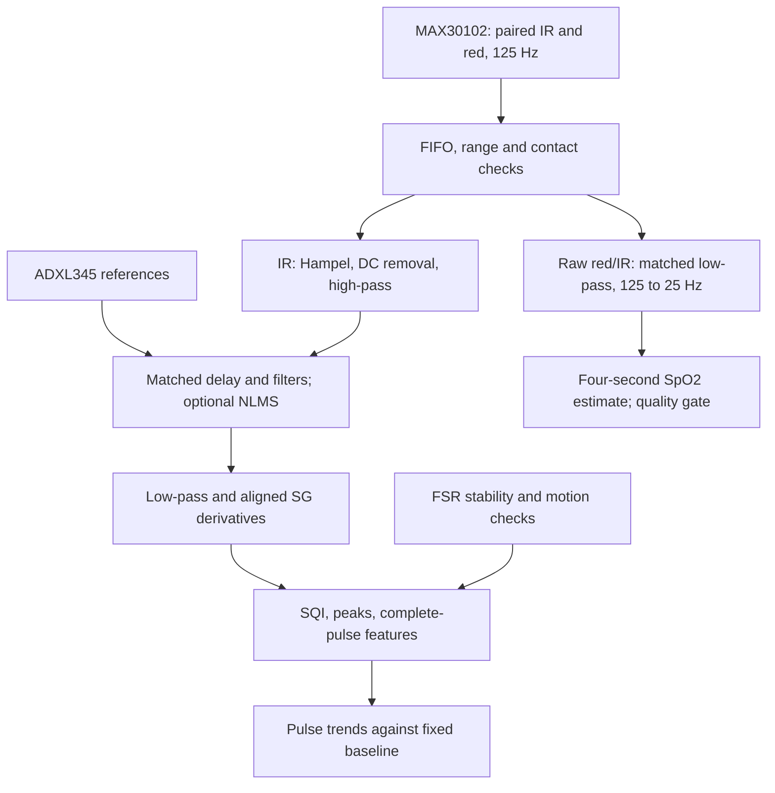

# Updated ESP32-S3 limb PPG research firmware

This folder replaces `BDD/ppg_esp32`. Open **ppg_esp32.ino** in Arduino IDE, or open this folder as a PlatformIO project. Start with the wiring table below, then read [the integration review](docs/INTEGRATION_REVIEW.md).

The update integrates the supplied `Libraries`, `PPG-SQI-Improved`, `minor-noise.zip` and `text1.txt` ideas into one executable acquisition and processing path. The uploaded BDD archive was the baseline: the live GitHub folder could not be retrieved for a current-commit comparison. No Claude URL was present in the message, text, source files, notebook or PDF links inspected.

**Purpose:** record distal optical pulsatility and pressure/motion context, and compare accepted pulse features with a deliberately captured baseline. These measurements do not establish adequate limb blood flow, measure flow in mL/min, or determine blood-flow direction. This is research firmware, not an automatic tourniquet controller. Do not use its trends to decide tourniquet application or release.

## What is connected

Assumption: **ESP32-S3 DevKitC-1 with N16R8 module**, MAX30102, two ADXL345s and two band FSRs. If your board differs, revise the pin mapping before connecting it.

| Function | ESP32-S3 connection | Details |
|---|---|---|
| I2C SDA | GPIO 8 | MAX30102 and both ADXL345s share the bus |
| I2C SCL | GPIO 9 | 400 kHz; pull-ups to 3.3 V |
| MAX30102 | I2C 0x57 | RED + IR, paired FIFO reads |
| Probe ADXL345 | I2C 0x53 | SDO to GND; CS to 3.3 V |
| Reference ADXL345 | I2C 0x1D | SDO to 3.3 V; CS to 3.3 V |
| Band FSR 1 | GPIO 4 | Buffered divider output, ADC1 |
| Band FSR 2 | GPIO 5 | Buffered divider output, ADC1 |
| Analog PPG reservation | GPIO 6 | Reserved only; no analog PPG driver selected |
| NIRS analog channel 1 reservation | GPIO 1 | Optional external AFE voltage output |
| NIRS analog channel 2 reservation | GPIO 2 | Optional external AFE voltage output |
| NIRS enable reservation | GPIO 10 | Not driven: AFE enable polarity is unknown |
| USB | GPIO 19/20 | Retained for native USB |

The ESP32-S3 has no GPIO22-25. Avoid the flash/PSRAM pins, particularly GPIO26-37 on this module. All grounds must be common. Use the supply voltage required by each **breakout board**; a bare MAX30102 chip is not a 3.3 V-only breakout. MCU inputs and I2C pull-ups must stay within the board's permitted levels.

FSR convention: 3.3 V -> FSR -> ADC node -> 10 kOhm -> GND. Use an appropriate buffer/RC filter. Firmware uses `analogReadMilliVolts()`, not a false assumption that ADC code 4095 equals 3.3 V. The calculated output is estimated conductance in microSiemens, not calibrated force or pressure. The present ADC saturation gate starts at 3090 mV; design the divider to keep its useful output below that range and calibrate your board.

## Bring-up

1. Extract the ZIP. Keep the entire `ppg_esp32` folder together. Back up the old folder, then replace it with this folder. Do not copy only the `.ino`.
2. Check `config.h`: board pins, FSR divider, `NUM_ACCEL`, pulse polarity, and sensor count. Default `NUM_ACCEL=2`; use 1 or 0 only when those sensors are actually absent. A missing configured accelerometer makes motion quality invalid.
3. In Arduino IDE select **ESP32S3 Dev Module**, USB CDC enabled, 16 MB flash, appropriate 16 MB partition, and OPI PSRAM for N16R8. Open `ppg_esp32.ino`. Only ESP32 Arduino core/Wire are needed; no MPU6050, Adafruit or SparkFun sensor library is required by this version.
4. Or, in VS Code / PlatformIO, open this folder and run `pio run -e esp32-s3-n16r8`, then `pio run -t upload`. The configuration pins Espressif32 6.9.0 for reproducibility; a real target build still needs to be performed on your system.
5. Open Serial Monitor at 460800 baud. Send `h` to reprint CSV headers. Native USB may ignore the numeric baud rate. Wait for filter settling and accepted pulses; startup is not instantaneous.
6. Inspect raw IR/RED and the upward systolic pulse. Change `INVERT_SIGNAL` if needed. Tune LED current and placement on recorded data. `MAX_LED_CURRENT_CODE=100` means register code 100, approximately **20 mA**, not 100 mA. Automatic gain changes are intentionally absent because they invalidate amplitude comparisons.
7. With the probe fixed and a stable intended baseline condition, send **b**. Ten consecutive accepted pulse reports establish a fixed median baseline. Send **r** to reset filters and baseline. Reboot after correcting an initial sensor-setup failure.
8. For research recordings set `STREAM_EVERY_N=1` and record every 125 Hz frame. The default 5 produces a 25 Hz preview stream while internal processing remains at 125 Hz. Decimated preview data cannot reproduce the original derivative pipeline.

No firmware-upload or hardware tests were possible in the preparation environment. See [validation](docs/VALIDATION.md) for exactly what was tested.

## Recommended flow



| Setting | Default |
|---|---|
| MAX30102 conversions | 1000/s, 118 us pulse width, average 8 |
| Effective FIFO pair rate | 125 Hz; `dt=0.008 s` |
| Hampel | 5 samples, threshold 5 x robust sigma |
| DC tracker / high-pass | 0.05 Hz / 2nd-order 0.15 Hz |
| Low-pass | 4th-order 10 Hz Butterworth |
| SG smoother and derivatives | 15 samples, cubic, 120 ms window |
| Known centered-filter delay | 9 samples = 72 ms, plus IIR phase delay |
| SQI | 5-second window, 1-second hop, autocorrelation near 25 Hz |
| ANC | Off initially; six available axes, 8 taps, mu 0.01 when enabled |
| SpO2 branch | Matched 6 Hz low-pass, average/decimate by 5 |
| SpO2 analysis | 100 samples at 25 Hz, 4 seconds, update every 1 second |

The SG delay is 7 samples, the Hampel delay is 2. Subtracting 72 ms corrects only those known delays. It does not undo the frequency-dependent IIR delay or prove that a detected notch is a physiological fiducial.

## Measurements and interpretation

| Output | Why it is included | Limitation |
|---|---|---|
| Pulse presence and interval | Whether repeatable pulsatility is detectable | Absence may reflect poor measurement, weak pulsatility or altered perfusion |
| Amplitude in ADC counts | Within-setup pulse-strength trend | Depends on LED drive, contact, tissue, placement and filters |
| Pulse PI (%) | 100 x pulse amplitude / raw DC level | This implementation's definition; not interchangeable with a commercial monitor |
| Pulse area / AUC | Integrates the complete pulse shape | Count-seconds, not blood volume or flow |
| Systolic/diastolic area | Shares one baseline with total AUC | Available only when a notch/inflection is detected |
| Crest time and 50% pulse width | Morphology and timing changes | Causal filtering and limb location affect both |
| VPG/APG and optional a-f indices | Exploratory morphology | Derivative sign does not indicate flow direction; not used as a clinical decision rule |
| FSR conductance and stability | Pressure-related confounding | Requires calibration to report force, and area/contact modeling to infer pressure |
| Raw accelerometers | Motion context and future ANC tuning | Two devices are approximately sampled together, not hardware synchronized |
| SpO2 estimate | Additional experimental optical channel | Unvalidated algorithm/site; not tissue oxygenation or proof of perfusion |

The original stiffness/aging index outputs are removed from the active reporting path. Normalizing pulse amplitude before measuring amplitude or AUC is also removed. `m04_smoothing.h` remains as a tested moving-average alternative; it is not cascaded with SG in the default pipeline.

`REDUCED_PULSE_TREND` means amplitude and PI are below 50% of the chosen baseline for three accepted pulses. It is an adjustable research rule, not a diagnosis. `PULSE_DETECTED` means a pulse was detected, not that circulation is adequate. Poor quality remains explicit; zero or an old value is not substituted for unavailable measurements.

## FSR roles, ANC and NIRS

The supplied project describes **both FSRs at the compression band**. They gate pressure stability, but low band pressure does not mean the optical probe is detached. Leave `CONTACT_FSR_INDEX=-1`. Set it to 0 or 1 only if that FSR is physically moved to the optical probe and its thresholds are calibrated. Optical count thresholds alone cannot reliably establish contact in every lighting condition.

ANC is integrated but defaults to off. One three-axis sensor can provide references; two are not mathematically required. With one sensor the other three channels are zero. This version uses six absolute, DC-removed axes rather than unvalidated integrated relative velocity. Align the reference board axes with `REFERENCE_AXIS_IDX/SIGN`, measure rest noise, then set `ANC_MIN_ENERGY`. Motion still gates feature reporting even when ANC is on. A nicer-looking waveform is not evidence that all motion artifact was removed.

**NIRS is not fully implemented because its hardware was unspecified.** GPIO1/2 and GPIO10 are reserved. `NIRS_MODE=1` enables raw logging only for an external AFE that already provides two safe, continuous analog outputs. An LED-multiplexed photodiode circuit, ADS1115, AFE4404, UART instrument, or commercial oximeter needs a different adapter. Wavelengths, source-detector distance, LED timing, dark/ambient subtraction, channel calibration and a validated model are required before deriving HbO2/HHb or StO2. MAX30102 SpO2 must not be relabeled as NIRS tissue saturation.

## Recording and desktop checks

```text
python -m pip install pyserial
python tools/capture.py --port COM5 --output session.csv
python tools/split_records.py session.csv --out session_tables
python tests/run_tests.py
```

The capture tool prints status lines and accepts `b`, `r`, `h` followed by Enter. `Ctrl+C` closes the file. Use a different COM port if necessary. The test runner requires g++/MinGW; it builds in a temporary folder. For sanitizer checks on a restricted Linux container use `ASAN_OPTIONS=detect_leaks=0 python tests/run_tests.py --sanitize` (address and undefined-behavior checks remain enabled).

Full raw recordings can be replayed through the same C++ pipeline with `tools/replay.cpp`; see its build/run comment. The replay rejects preview-only recordings and resets on epoch/timing gaps.

See [CSV and modules](docs/MODULES_AND_OUTPUT.md), [integration review](docs/INTEGRATION_REVIEW.md), and [hardware validation steps](docs/VALIDATION.md). `legacy/` contains the original headers for comparison only; the active firmware does not include them.
